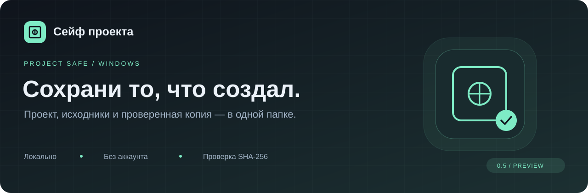
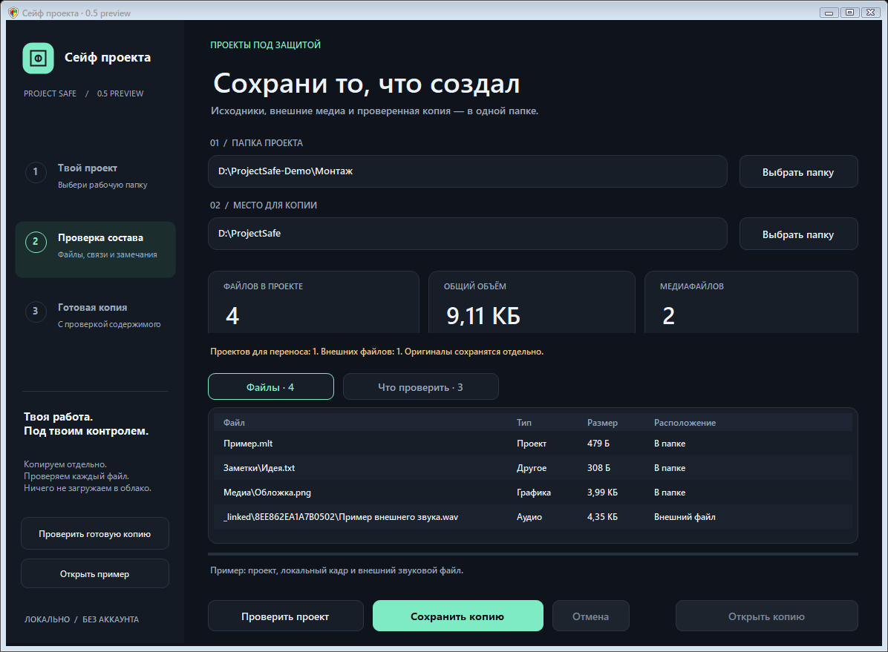

<p align="center">
  <a href="https://github.com/pahantu/project-safe/actions/workflows/windows.yml"></a>
  · <strong>Windows · .NET Framework 4.x · 0.5 preview</strong>
</p>

<p align="center">
  <a href="#быстрый-старт">Быстрый старт</a> ·
  <a href="#редакторы">Редакторы</a> ·
  <a href="docs/USAGE.ru.txt">Инструкция</a> ·
  <a href="#использование-кода">Условия использования</a>
</p>

## Твоя работа. Под твоим контролем.

**Сейф проекта** собирает файлы монтажного проекта в отдельную папку и проверяет
содержимое копии. Помогает найти внешние медиа и увидеть недостающие исходники
до переноса на другой диск.

| Собрать | Проверить | Перенести |
|---|---|---|
| Проект и доступные внешние медиа | Состав, замечания и SHA-256 файлов | Всю папку сейфа вместе с картой путей |

Всё происходит локально: без аккаунта и загрузки материалов в облако.
Исходные файлы остаются на месте.



> **Предварительная версия.** Уровень поддержки зависит от редактора.
> Проверка хешей подтверждает целостность файлов; полноту монтажа нужно проверять в редакторе.

## Быстрый старт

Нужна Windows с .NET Framework 4.x и PowerShell. Внешних библиотек для C#-приложения нет.

1. Скачай исходники: **Code → Download ZIP**, распакуй архив.
2. Открой PowerShell в папке проекта и собери приложение:

   ```powershell
   powershell.exe -NoProfile -ExecutionPolicy Bypass -File .\build.ps1
   & '.\Сейф проекта.exe'
   ```

3. Выбери рабочую папку и отдельное место для копии.
4. Нажми **«Проверить проект»**, прочитай вкладку **«Что проверить»**.
5. Нажми **«Сохранить копию»**. Переноси всю созданную папку целиком.

Кнопка **«Открыть пример»** создаёт небольшой искусственный проект в
`%LOCALAPPDATA%\ProjectSafe`; свои материалы для знакомства не нужны.

Готовая тестовая сборка также доступна в разделе **Actions → успешный запуск → Artifacts**
в течение 7 дней после запуска. Для скачивания артефакта GitHub нужен вход в аккаунт.

## Редакторы

| Редактор | Что умеет Сейф | После переноса |
|---|---|---|
| **Shotcut** | Основные MLT-ссылки и медиа | Отдельная копия `Ready` с относительными путями |
| **Kdenlive** | Документ 1.1, основные медиа, прокси и оригиналы | Отдельная копия `Ready`, ограничения в замечаниях |
| **OpenShot** | Версии 4.1.x, основные медиа и поддержанные ресурсы | Отдельная копия `Ready` |
| **Premiere Pro** | Экспериментальный сбор известных ссылок PRPROJ/XML/gzip | Ручная перепривязка |
| **After Effects** | Ссылки из AEPX или выгрузки `.psdeps` через JSX | Ручная перепривязка |
| **Final Cut / Resolve XML** | Доступные ссылки FCPXML и обменного xmeml | Ручная перепривязка |
| **Resolve DRP, VEGAS, CapCut** | Только файлы выбранной папки | Внутренние связи не разбираются |

Оригиналы лежат в `Project`. Папка `Ready` создаётся только для поддержанных вариантов
Shotcut, Kdenlive и OpenShot. **Adobe/XML не создают `Ready`.**

Шрифты, плагины, Dynamic Link, LUT, выражения с файлами и серии кадров требуют отдельной
проверки. Сетевые ресурсы автоматически не скачиваются. Бинарные AEP и нативные DRP
не переписываются. Обнаружение ссылок не гарантирует полноту зависимостей.

Подробности и проверенные границы: [матрица поддержки](docs/EDITORS.ru.md).

<details>
<summary><strong>Как устроена копия</strong></summary>

```text
Папка сейфа/
├── Project/                 оригиналы и собранные внешние файлы
├── Ready/                   отдельные проекты поддержанных редакторов, если доступны
├── manifest.json            список файлов и контрольные суммы
└── Карта исходников.tsv     исходные и новые пути
```

В папке также сохраняется инструкция. Проверить готовую копию можно отдельной кнопкой
в приложении. Исходный проект не изменяется.

</details>

## Проверки и развитие

**41 сценарий C#** и **7 проверок контракта JSX на модели API** проходят локально;
сборка и тесты также запускаются в GitHub Actions на Windows.

Для Shotcut, Kdenlive и OpenShot ранее выполнены нативные проверки открытия и экспорта.
**Premiere, After Effects, Resolve и Final Cut в самих редакторах ещё не проверены.**
Тесты Adobe/XML используют синтетические документы, а модель API не заменяет запуск Adobe.

```powershell
.\test.ps1
node .\tests\ae-exporter.cjs
```

Следующий этап — нативная проверка DaVinci Resolve: архив с медиа, другой диск,
повторное открытие и сравнение экспорта. До этой проверки поддержка DRP не заявляется.

[История изменений](CHANGELOG.md) · [Участие в разработке](CONTRIBUTING.md) ·
[Сообщить о проблеме](https://github.com/pahantu/project-safe/issues)

## Использование кода

Исходный код открыт для просмотра и доступен по
**[PolyForm Noncommercial License 1.0.0](LICENSE.md)**.

- Можно изучать, изменять и распространять программу в некоммерческих целях.
- При распространении нужно сохранять условия лицензии и обязательные уведомления из [NOTICE](NOTICE).
- Продажа программы, её изменённых версий и иное коммерческое использование требуют
  отдельного разрешения правообладателя, если такое использование не разрешено самой лицензией.

Это **source-available** проект с ограничением коммерческого использования.
Для отдельного разрешения [свяжись с владельцем проекта через issue](https://github.com/pahantu/project-safe/issues).
Полные условия определяет текст лицензии.
